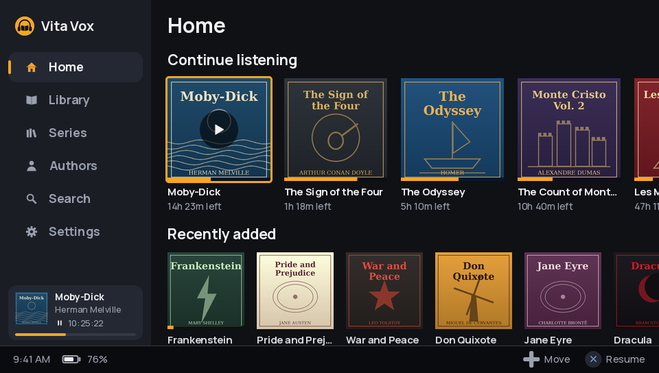
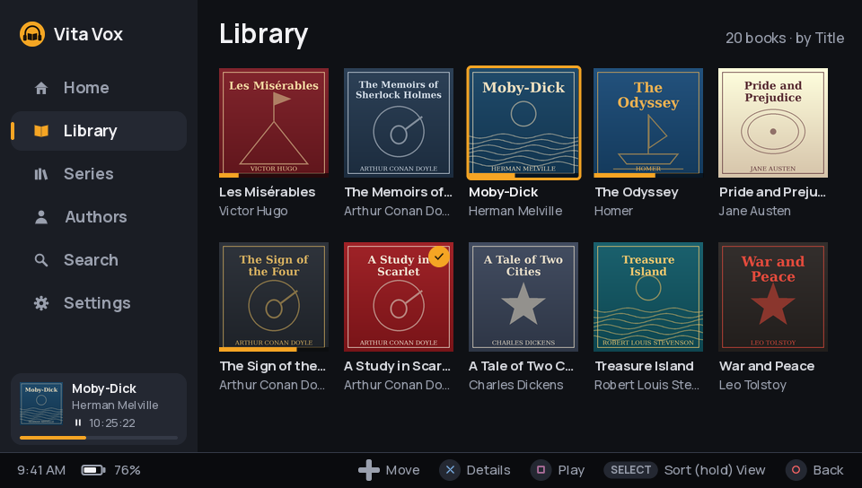
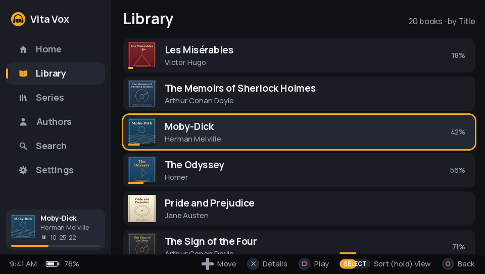
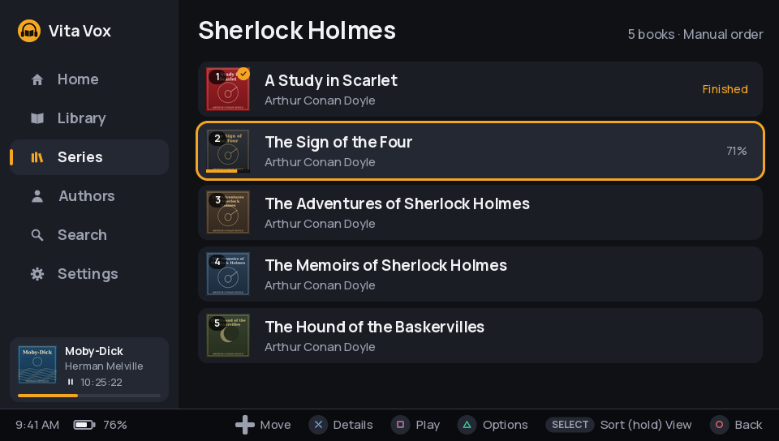
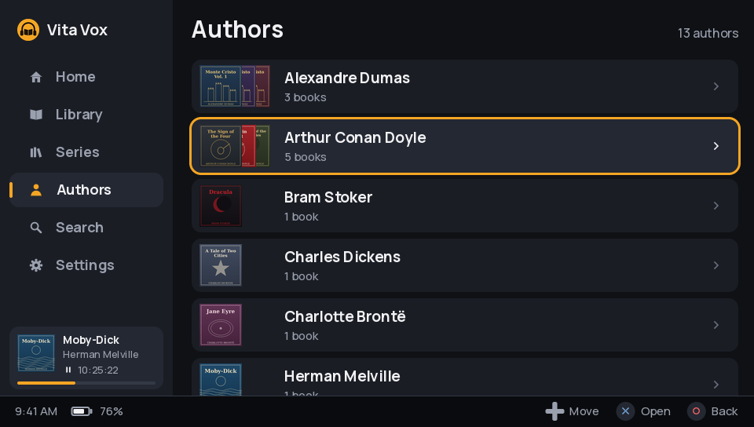
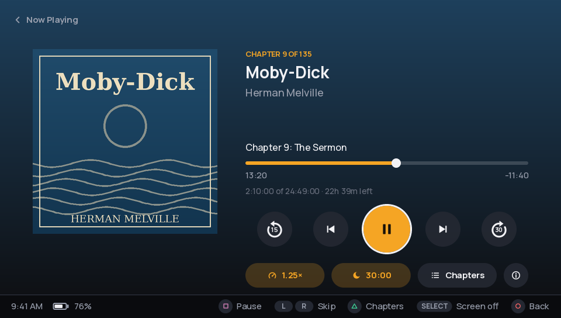
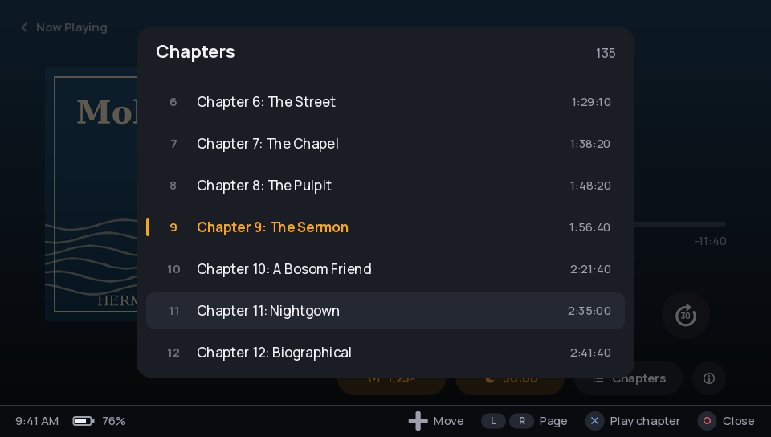
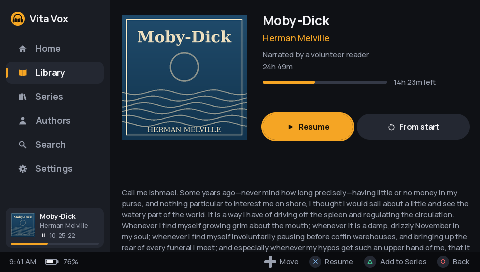
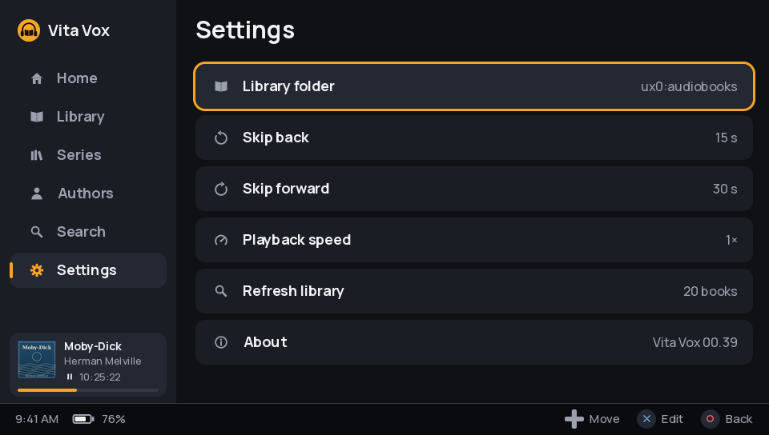
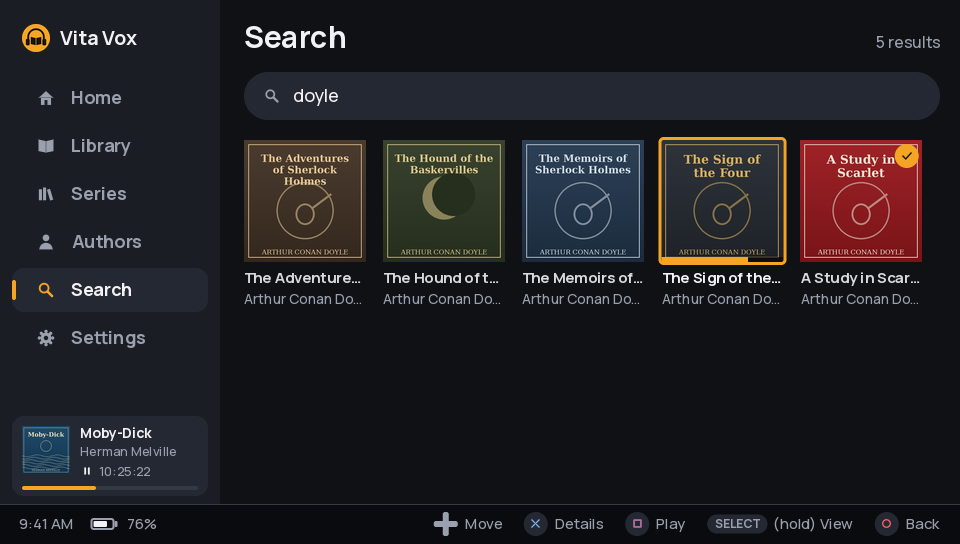

<p align="center">
  
</p>

# Vita Vox

**Offline audiobook player for PS Vita.**

Version **00.39**. Title ID `VVOX00001`. There is no server, sync, streaming, or network code in the app.

## Fork of ABSvita

This is a fork of [ABSvita](https://github.com/DarthTigerson/ABSvita) by [DarthTigerson](https://github.com/DarthTigerson), released under the MIT License. The original copyright and licence are kept in [`LICENSE`](LICENSE).

The UI shell, playback engine thread, sonic speed/pitch, vita2d interface, background and screen-off playback (`ATTRIBUTE 0x88008`, BGM audio port, power tick), on-screen keyboard (IME), sleep timer, and chapter list come from that codebase.

**What changed versus ABSvita:** this fork is offline only. Audiobookshelf client code, logins, and downloads were removed. The Helix and custom MP4/MP3 decoders were replaced with a project-built, decoder-only **LGPL FFmpeg**, so local files in many formats (including FLAC, M4B, MP3, Ogg, and Opus) play from the memory card. Library scanning, cover thumbnails, user-managed series, and folder-as-book behaviour follow the Android app [Voice](https://github.com/PaulWoitaschek/Voice) (folder = book, a loose file at the library root = a book, natural file sort, resume, chapters, sleep timer, playback speed). Voice itself is GPLv3; this project copies that behaviour only, never Voice source.

## Features

- Local library of MP4/M4A/M4B, MP3, AAC, FLAC, Ogg/Opus, Matroska/WebM, WAV, AIFF, WMA/ASF, APE, WavPack, CAF, and TTA
- Resume position and speed per book; **Continue listening** and **Recently added** on Home
- Chapters (from the file, or one chapter per file in a multi-file book), L/R skip, playback speed 0.75×–2× (sonic)
- Sleep timer (15 / 30 / 45 / 60 minutes, or end of chapter); fades out, then pauses, saves progress, and turns the display off
- Book details with a description taken from the first audio file’s comment / description tags
- Cover art: 256 px thumbnails in menus, a 500 px cover on the player after audio has started
- User-managed series (alphabetical or a manual order), an Authors list, and Search
- Library and Search can be a five-column grid or a list (hold **SELECT** for two seconds). A series remembers its own list/grid choice
- Clock, battery icon, and percentage in the hint bar (follows the system 12/24-hour setting)
- Playback continues in the background and with the screen off (BGM audio port). **SELECT** in the player also turns the display off; any button or a touch wakes it
- First scans and large many-file books are built in the background; opening a book is prioritised over the scan; MP3 lengths can be read from the file header
- Library folder is set in Settings (default `ux0:audiobooks/`)
- Debug log at `ux0:data/VitaVox/debug.log`

## Screenshots

Screenshots are mockups of the real UI rendered with sample public-domain books.

| Home | Library (grid) |
|---|---|
|  |  |

| Library (list view) | Inside a series (list) |
|---|---|
|  |  |

| Authors | Now Playing |
|---|---|
|  |  |

| Chapters | Book details |
|---|---|
|  |  |

| Settings | Search |
|---|---|
|  |  |

## Beginner’s guide

### What you need

- A PlayStation Vita or Vita TV that can run homebrew (**HENkaku**, usually with **Ensō** so it lasts after a reboot)
- **[VitaShell](https://github.com/TheOfficialFloW/VitaShell)** (or another file manager that can copy files and install VPKs)
- Storage: the official memory card, or **SD2Vita** (an SD card that appears as `ux0:`). SD2Vita is optional but is the usual way to have enough room for audiobooks
- A computer to download the VPK and copy audiobooks

This app does not jailbreak the Vita. If your console cannot already install VPKs, look up a current HENkaku / Ensō guide first.

### 1. Download the VPK

On a computer, open this repository’s **[Releases](../../releases)** page and download `vita_vox_v00.39.vpk`.

### 2. Copy it to the Vita

**USB (VitaShell):**

1. Open VitaShell on the Vita.
2. Press **SELECT** to start USB mode (the Vita appears as a drive on the computer).
3. Copy `vita_vox_v00.39.vpk` to a folder you can find later, for example `ux0:vpk/`.
4. Eject the drive, then press **SELECT** again on the Vita to leave USB mode.

**FTP (VitaShell):**

1. In VitaShell, start the FTP server (**START** on current VitaShell) and note the address shown on screen.
2. On the computer, connect with an FTP client and upload the VPK to `ux0:vpk/` (or any folder you prefer).

### 3. Install the VPK

In VitaShell, highlight `vita_vox_v00.39.vpk` and press **OK** (Cross or Circle, matching your system confirm button). Accept the install. Vita Vox appears on the LiveArea like any other app.

### 4. Put your audiobooks on the card

The default library folder is **`ux0:audiobooks/`**. Create that folder if it is not there yet (the app also creates it on a first install), then copy your books into it.

A **subfolder** is one book. A **single audio file** sitting directly in `ux0:audiobooks/` is also a book. Optional cover art: `cover.jpg`, `cover.png`, `folder.jpg`, or `folder.png` (other jpg/png images in the folder, including inside disc folders, are also considered). If there is no folder image, embedded cover art from the file is used.

```
ux0:audiobooks/
  Moby-Dick (Unabridged).m4b
  Pride and Prejudice/
    Pride and Prejudice.m4b
    cover.jpg
  Les Miserables/                  ← many files = one book (tracks sorted naturally)
    0101 - Introduction.mp3
    0102 - Preface.mp3
    0103 - Book 1 Chapter 1.mp3
    …
  Sherlock Holmes/
    4 - The Sign of the Four/      ← disc folders (Disc 1, CD2, Part 1, …) merge into one book
      Disc 1/
        01 - The Science of Deduction.flac
        …
        cover.jpg
      Disc 2/
        …
  The Count of Monte Cristo/       ← a folder of books you can later group as a series in the app
    The Count of Monte Cristo 07 - The Prisoner/
      The Count of Monte Cristo, Vol. 07.m4b
      cover.jpg
    The Count of Monte Cristo 08 - The Escape/
      …
```

Supported containers include MP4/M4A/M4B, MP3, AAC, FLAC, Ogg/Opus, Matroska/WebM, WAV, AIFF, WMA/ASF, APE, WavPack, CAF, and TTA.

Copy the tree the same way you copied the VPK (USB or FTP). You can add more books later; use **Settings → Refresh library** (or open a new library folder) when you want the list updated.

### 5. First launch

Open **Vita Vox** from the LiveArea. The first scan of a large library runs in the background: titles and covers can appear before every length is known (a many-file book may show *Length: scanning…* until its parts are timed). Opening a book is prioritised over the scan, so you do not have to wait for the whole folder to finish.

Home shows **Continue listening** and **Recently added** once books are in the list.

### Controls

OK and Back follow the console’s Enter-button setting (normally Cross / Circle). The left stick is treated as a D-pad.

**Everywhere in the main UI**

| Control | Action |
|---|---|
| D-pad / left stick | Move focus |
| L / R | Previous / next sidebar section |
| Triangle | Jump to Search (unless the current view uses Triangle itself) |
| Start | Open Now Playing if a book is loaded |
| Left / Back | Leave a section for the sidebar, or go back |

**Library, Search, and books inside a series or author**

| Control | Action |
|---|---|
| OK | Open book details (or the search field) |
| Square | Play / resume the focused book |
| SELECT, short press (release before 2 s) | Library and a series’ books: cycle sort (Title / Author / Recently added, or Alphabetical / Manual in a series). Search and an author’s books have no sort action |
| SELECT, hold 2 s | Toggle list view and grid view. A fill grows on the SELECT hint; a toast says *List view* or *Grid view* |
| Touch | Tap a cell or a full list row to open it; drag to scroll (flick for momentum) |

The Library and Search each remember their list/grid choice. A series remembers its own choice. An author’s books always open in the grid; list mode lasts only for that visit. Holding SELECT on the Series or Authors *tabs* (the lists of names) does nothing.

**Player (Now Playing)**

| Control | Action |
|---|---|
| Square | Play / pause |
| L / R | Skip back / forward (the hint is *(L) (R) Skip*; defaults 15 s and 30 s, changeable in Settings) |
| Triangle | Chapters |
| SELECT | Turn the display off (audio continues). Any button or a touch wakes it |
| Back | Return to the library |
| Touch | Tap the progress bar to jump, or slide along it (one seek on release; slide far off the bar to cancel). Tap a chapter, or tap outside the Chapters panel to close it |

**Series**

- OK on *New Series* names a series with the keyboard; OK on a series opens it.
- Triangle on a series: Open / Rename / Delete.
- Inside a series, Triangle opens Options (add books, sort, move, remove, rename, delete).
- Book details: Triangle = *Add to Series*.

**Home and Settings**

- Home: Continue listening and Recently added. On an empty or failed library, SELECT (or OK) can Refresh / retry.
- Settings: library folder, skip times, default speed, Refresh, About (`Vita Vox 00.39`). Press OK on About five times to show the hidden **Debug: record output (60 s)** option.

### Changing the library folder

**Settings → Library folder** opens the keyboard. The folder is checked before anything changes:

- The drive must be one of `ux0:`, `uma0:`, `imc0:`, `ur0:`, `grw0:`, `xmc0:`
- The drive must be available, and the folder must already exist

Otherwise the change is refused and the previous folder is kept (for example *Folder not found: ux0:books - library folder unchanged*). Typing is forgiving: `UX0:/audiobooks/` is the same folder as `ux0:audiobooks`.

When a new folder is accepted, playback stops first (position saved, player closed), then the Library shows exactly what is in the new folder. Each folder keeps its own saved list, so switching back shows that folder’s books, progress, covers, and series.

### Troubleshooting / FAQ

**I set the library to `ux0:music` (or another path) and nothing changed.**  
The folder must already exist on a supported, mounted drive. If it does not, the change is refused and a toast explains why, for example *Folder not found: ux0:music - library folder unchanged*. Create the folder first (in VitaShell), or use the default `ux0:audiobooks`. The official Music app’s folder is not special-cased: if `ux0:music` exists it can be used, but a dedicated audiobook folder is usually clearer.

**Where is the log?**  
`ux0:data/VitaVox/debug.log`. It is capped at 4 MB; when full it is renamed to `debug.old.log` and a new log starts, so the two files never take more than 8 MB. Copy it off with VitaShell if you need to report a problem.

**The first scan of a large library is slow.**  
That is expected, especially for many-file books or a first visit with no probe cache. Titles and covers can show before every length is finished. You can open a book while the scan continues. Later visits reuse the cache and are much faster. **Settings → Refresh library** rebuilds the list after you add or remove files.

**The Library is empty and says *Can't open …*.**  
The configured folder is missing (for example the SD2Vita card is not inserted). The app will not create that folder or show another folder’s books. Fix the path in Settings, or insert the card and reopen the app.

**A book has no length, or it says *Length: scanning…*.**  
Its parts are still being timed, or a file needed a full probe. Leave the app open, or open the book; the length is stored in the probe cache for next time.

**Playback stutters, or I want more detail.**  
The log has an `audio: stats` line every 5 s while playing, and `audio: underrun` / `audio: late device write` lines when those happen. Hidden debug: in Settings, press OK on **About** five times, then **Debug: record output (60 s)** writes the next minute of sound (exactly as sent to the speaker, after speed) to `ux0:data/VitaVox/debug/`.

## Building from source

To build the VPK you need [VitaSDK](https://vitasdk.org/) and a one-time cross-compile of the project’s decoder-only FFmpeg (`./scripts/build_ffmpeg.sh`). Then:

```sh
mkdir -p build && cd build
cmake ..
make -j$(nproc)
```

The package is `build/vita_vox_v00.39.vpk`. Host tests (no Vita required): `make -f Makefile.host test`.

Full toolchain, FFmpeg, test, and LiveArea notes: **[docs/BUILDING.md](docs/BUILDING.md)**.

## Documentation

- [Overview](docs/OVERVIEW.md) — features, controls, and data on the memory card
- [Architecture](docs/ARCHITECTURE.md) — modules, threads, the audio and library pipelines
- [Building](docs/BUILDING.md) — toolchain, VPK, host tests, LiveArea assets
- [Changelog](docs/CHANGELOG.md) — history from the git log (0.2.x through 00.39)

## Licence and credits

Vita Vox is **MIT**, following ABSvita. See [`LICENSE`](LICENSE) (copyright DarthTigerson and Vita Vox contributors).

| Component | Licence / notes |
|---|---|
| [ABSvita](https://github.com/DarthTigerson/ABSvita) by DarthTigerson | MIT; UI shell, engine thread, vita2d, sleep timer, IME, and related playback behaviour |
| FFmpeg (project-built, decoder-only, no GPL features, no encoders, muxers, or network) | LGPL; see `scripts/build_ffmpeg.sh` |
| [sonic](https://github.com/waywardgeek/sonic) | Apache 2.0 (`vendor/sonic/`) — playback speed |
| [cJSON](https://github.com/DaveGamble/cJSON) | MIT (`vendor/cjson/`) |
| [stb](https://github.com/nothings/stb) (`stb_image`) | MIT / public domain (`vendor/stb/`) |
| [Manrope](https://github.com/sharanda/manrope) | SIL Open Font License 1.1 (`assets/fonts/OFL.txt`) |
